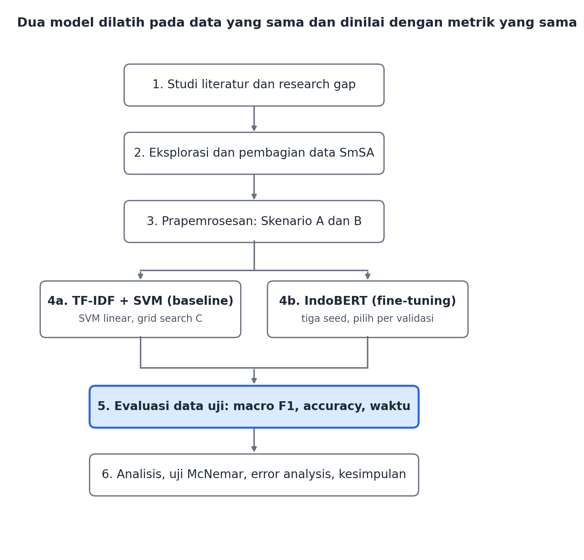

# Proposal Penelitian: Perbandingan TF-IDF + SVM dan IndoBERT untuk Klasifikasi Sentimen Ulasan Berbahasa Indonesia

**Mata Kuliah:** Riset Informatika (UTS)  
**Nama / NIM:** Mochamad David Ainur Rochman/ 23081010239 

## ABSTRAK

::: {custom-style="Abstract" lang=id}
Ulasan pengguna berbahasa Indonesia yang terus bertambah di platform digital menuntut analisis sentimen otomatis yang akurat dan efisien. Penelitian ini bertujuan membandingkan dua pendekatan klasifikasi sentimen tiga kelas (positif, netral, dan negatif), yaitu TF-IDF dengan Support Vector Machine (SVM) sebagai baseline klasik dan IndoBERT sebagai model bahasa pre-trained yang di-fine-tune, pada dataset benchmark SmSA dari IndoNLU. Perbandingan dilakukan pada dua skenario prapemrosesan, yaitu pembersihan minimal dan pembersihan disertai normalisasi kata tidak baku, sehingga pengaruh normalisasi terhadap masing-masing model dapat dianalisis. Kinerja dievaluasi menggunakan accuracy, precision, recall, F1-score (dengan macro F1 sebagai metrik utama), dan confusion matrix, serta dilengkapi pengukuran waktu pelatihan dan inferensi untuk menilai keseimbangan antara akurasi dan biaya komputasi. Pada IndoBERT, eksperimen diulang dengan beberapa random seed, dan perbedaan kinerja antarmodel diuji secara statistik. Penelitian dirancang untuk berjalan pada lingkungan sumber daya terbatas (Google Colab) agar relevan bagi mahasiswa dan praktisi dengan keterbatasan perangkat. Dokumen ini memuat latar belakang, tinjauan pustaka, dan metodologi yang direncanakan; hasil eksperimen akan dilaporkan pada tahap berikutnya.

**Kata Kunci:** analisis sentimen; bahasa Indonesia; IndoBERT; TF-IDF; SVM; klasifikasi teks; normalisasi teks
:::

::: {custom-style="Abstract" lang=en}
Indonesian-language user reviews keep growing on digital platforms, which demands accurate and efficient automatic sentiment analysis. This study compares two approaches to three-class sentiment classification (positive, neutral, and negative): TF-IDF with Support Vector Machine (SVM) as a classical baseline, and IndoBERT as a pre-trained language model that is fine-tuned, on the SmSA benchmark dataset from IndoNLU. The comparison uses two preprocessing scenarios, namely minimal cleaning and cleaning with nonstandard word normalization, so that the effect of normalization on each model can be analyzed. Performance is evaluated using accuracy, precision, recall, F1-score (with macro F1 as the primary metric), and the confusion matrix, complemented by training and inference time measurements to assess the trade-off between accuracy and computational cost. For IndoBERT, the experiments are repeated with several random seeds, and differences in performance between models are tested statistically. The study is designed to run in a resource-constrained environment (Google Colab) so that it remains relevant for students and practitioners with limited hardware. This document contains the background, literature review, and planned methodology; experimental results will be reported at the next stage.

**Keywords:** sentiment analysis; Indonesian language; IndoBERT; TF-IDF; SVM; text classification; text normalization
:::

## BAB 1 PENDAHULUAN

### 1.1 Latar Belakang

Pertumbuhan platform digital seperti e-commerce, layanan pemesanan makanan, dan media sosial membuat jumlah ulasan pengguna dalam bahasa Indonesia meningkat pesat. Ulasan ini berisi opini yang berguna bagi pelaku usaha untuk mengevaluasi produk dan layanan. Namun, membaca ulasan satu per satu tidak efisien, sehingga dibutuhkan analisis sentimen otomatis yang mengklasifikasikan teks menjadi sentimen positif, netral, atau negatif.

Analisis sentimen berbahasa Indonesia memiliki tantangan tersendiri: banyak kata tidak baku, singkatan, slang, campuran bahasa daerah dan Inggris, serta sumber daya bahasa yang lebih terbatas dibanding bahasa Inggris. Pendekatan klasik seperti representasi TF-IDF yang dipadukan dengan Support Vector Machine (SVM) masih sering digunakan karena ringan dan cepat. Di sisi lain, model berbasis Transformer seperti IndoBERT yang sudah dilatih awal (pre-trained) pada korpus bahasa Indonesia dilaporkan memberi performa lebih baik pada berbagai tugas bahasa Indonesia, tetapi membutuhkan sumber daya komputasi yang lebih besar.

Bagi mahasiswa dan praktisi dengan sumber daya terbatas (misalnya hanya menggunakan GPU gratis di Google Colab), pertanyaan yang penting adalah seberapa besar keunggulan IndoBERT dibanding SVM, dan apakah keunggulan tersebut sebanding dengan tambahan biaya komputasinya. Selain itu, pengaruh normalisasi kata tidak baku terhadap kedua pendekatan tersebut juga perlu diuji. Penelitian ini mencoba menjawab pertanyaan-pertanyaan tersebut dalam skala kecil dan dapat direproduksi.

Dari sisi praktik, pelaku usaha kecil dan menengah di Indonesia semakin bergantung pada ulasan pelanggan untuk memperbaiki produk, menyusun strategi promosi, dan memantau reputasi merek. Satu produk populer dapat menerima ribuan ulasan setiap bulan, sehingga pembacaan manual tidak lagi memungkinkan. Klasifikasi sentimen otomatis menawarkan cara cepat untuk meringkas opini tersebut menjadi proporsi sentimen positif, netral, dan negatif yang mudah dipantau.

Dari sisi akademis, penelitian analisis sentimen bahasa Indonesia dilakukan pada dataset yang beragam, dengan skema prapemrosesan dan pembagian data yang tidak seragam. Kondisi ini menyulitkan pembandingan hasil karena dataset dan skema prapemrosesan yang berbeda antarstudi membuat pembaca sulit memutuskan pendekatan mana yang layak dipilih. Penggunaan dataset benchmark yang sama, dengan protokol eksperimen yang jelas, memungkinkan perbandingan yang lebih adil dan dapat direproduksi.

Berdasarkan uraian tersebut, penelitian ini membandingkan dua pendekatan yang mewakili dua generasi metode klasifikasi teks, yaitu TF-IDF + SVM (pendekatan klasik berbasis fitur) dan IndoBERT (pendekatan berbasis model bahasa pre-trained), pada dataset benchmark yang sama dengan dua skenario prapemrosesan. Hasilnya diharapkan memberi gambaran kuantitatif tentang keuntungan dan biaya dari masing-masing pendekatan.

Perkembangan pemrosesan bahasa alami (Natural Language Processing, NLP) dalam beberapa tahun terakhir ditandai oleh peralihan dari fitur yang dirancang manual menuju model bahasa pre-trained berskala besar, yaitu model yang lebih dahulu dilatih pada data tanpa label dalam jumlah besar lalu disesuaikan untuk tugas tertentu. Untuk bahasa Indonesia, peralihan ini ditopang oleh tersedianya benchmark dan model pre-trained terbuka, sehingga pengembang tidak perlu melatih model dari awal. Meski demikian, ketersediaan model tidak otomatis menjawab pertanyaan praktis yang dihadapi pengguna: apakah model besar selalu layak dipakai, dan seberapa besar selisih kinerjanya terhadap metode sederhana yang sudah lama dikenal.

Pertanyaan tersebut penting karena penerapan model Transformer menuntut GPU, waktu pelatihan yang lebih panjang, dan pengetahuan teknis tambahan. Sebaliknya, TF-IDF dengan SVM dapat dilatih pada CPU dalam hitungan detik hingga menit. Bagi organisasi kecil, selisih kinerja beberapa poin persentase mungkin tidak sebanding dengan tambahan biaya, tetapi selisih yang besar akan membenarkan investasi tersebut. Tanpa perbandingan yang terkontrol, keputusan semacam ini sering diambil berdasarkan anggapan umum, bukan bukti empiris. Selain itu, praktik prapemrosesan seperti normalisasi kata tidak baku sering dijalankan secara otomatis tanpa diuji, padahal pengaruhnya dapat berbeda antara model berbasis kata dan model berbasis subword.

Oleh karena itu, penelitian ini dirancang sebagai studi perbandingan terkontrol pada skala yang dapat dikerjakan oleh satu peneliti dengan sumber daya terbatas. Penelitian ini tidak bermaksud mengusulkan arsitektur baru, melainkan menyediakan bukti empiris yang jelas, dapat direproduksi, dan berguna sebagai panduan pemilihan metode untuk klasifikasi sentimen berbahasa Indonesia.

### 1.2 Rumusan Masalah

1. Bagaimana performa model TF-IDF + SVM dibandingkan IndoBERT pada klasifikasi sentimen tiga kelas ulasan berbahasa Indonesia?
2. Bagaimana pengaruh normalisasi kata tidak baku terhadap performa kedua model?
3. Bagaimana perbandingan biaya komputasi (waktu pelatihan dan inferensi) antara kedua model?

Ketiga rumusan masalah di atas dijawab melalui eksperimen terkontrol: dataset, pembagian data, dan metrik evaluasi dibuat identik untuk semua model, sehingga perbedaan hasil dapat dikaitkan dengan model dan skenario prapemrosesan yang diuji, bukan dengan perbedaan data.

### 1.3 Tujuan Penelitian

1. Mengukur dan membandingkan performa TF-IDF + SVM dan IndoBERT menggunakan metrik accuracy, precision, recall, dan F1-score.
2. Menganalisis pengaruh tahap normalisasi teks terhadap performa masing-masing model.
3. Membandingkan waktu pelatihan dan inferensi untuk menilai keseimbangan antara akurasi dan efisiensi.

Tujuan pertama menjawab rumusan masalah pertama melalui perbandingan metrik klasifikasi pada data uji. Tujuan kedua menjawab rumusan masalah kedua melalui eksperimen dengan dan tanpa normalisasi. Tujuan ketiga menjawab rumusan masalah ketiga melalui pengukuran waktu dan sumber daya. Hasil ketiganya digabungkan pada tahap analisis untuk menyusun rekomendasi pemilihan model.

### 1.4 Batasan Masalah

1. Dataset yang digunakan adalah dataset publik berbahasa Indonesia untuk analisis sentimen tiga kelas (positif, netral, negatif).
2. Model yang dibandingkan hanya dua: TF-IDF + SVM sebagai baseline dan IndoBERT-base yang di-fine-tune.
3. Eksperimen dijalankan pada lingkungan Google Colab dengan GPU gratis.
4. Penelitian tidak mencakup analisis sentimen berbasis aspek (aspect-based) maupun deteksi sarkasme.

Batasan-batasan tersebut ditetapkan agar penelitian dapat diselesaikan dalam satu semester dengan kualitas yang terjaga. Pembatasan pada dua model memungkinkan penyetelan hyperparameter dan pengulangan eksperimen yang cukup untuk masing-masing model, daripada membandingkan banyak model secara dangkal. Pembatasan pada satu dataset benchmark memastikan bahwa perbedaan hasil tidak bercampur dengan perbedaan data. Konsekuensinya, kesimpulan penelitian berlaku untuk kondisi yang diuji dan tidak serta-merta dapat digeneralisasi ke domain lain; keterbatasan ini dibahas pada subbab ancaman terhadap validitas.

### 1.5 Manfaat Penelitian

- **Akademis:** memberi bukti empiris perbandingan model klasik dan Transformer untuk bahasa Indonesia pada kondisi sumber daya terbatas.
- **Praktis:** membantu pengembang kecil memilih model yang sesuai dengan kebutuhan dan anggaran komputasi.

### 1.6 Hipotesis Penelitian

Sebelum eksperimen dijalankan, penelitian ini mengajukan tiga hipotesis kerja:

- **H1:** IndoBERT menghasilkan macro F1-score yang lebih tinggi daripada TF-IDF + SVM pada data uji.
- **H2:** Normalisasi kata tidak baku memberi peningkatan yang lebih besar pada TF-IDF + SVM daripada pada IndoBERT, karena representasi TF-IDF berbasis kata sangat sensitif terhadap variasi penulisan.
- **H3:** IndoBERT membutuhkan waktu pelatihan dan inferensi yang lebih besar daripada TF-IDF + SVM.

Hipotesis ini adalah dugaan awal yang akan diuji melalui eksperimen; hasil yang berlawanan tetap akan dilaporkan dan dianalisis.

**Catatan penyesuaian setelah eksplorasi data.** Dataset SmSA ternyata sudah dinormalisasi sebagian oleh penyedianya (huruf kecil, tanda baca dipisahkan spasi), dan kata informal hanya muncul pada 3,6% teks latih, tetapi pada 20,2% teks uji. Karena itu efek normalisasi pada data uji asli diperkirakan kecil, dan H2 diuji pada tiga kondisi (data uji asli, subset informal, dan data uji dengan gangguan sintetis) seperti dirinci pada subbab 3.19.

### 1.7 Sistematika Penulisan

Proposal ini disusun dalam tiga bab. **Bab 1 Pendahuluan** memuat latar belakang, rumusan masalah, tujuan, batasan, manfaat, dan hipotesis. **Bab 2 Tinjauan Pustaka** membahas landasan teori (analisis sentimen, prapemrosesan, TF-IDF, SVM, Transformer, BERT, IndoBERT, dan metrik evaluasi), penelitian terkait, research gap, serta kerangka pemikiran. **Bab 3 Metodologi** menjelaskan jenis penelitian, variabel, dataset, prapemrosesan, model, skenario eksperimen, rencana evaluasi dan analisis, lingkungan kerja, jadwal, ancaman validitas, dan luaran penelitian. Lampiran berisi rencana dataset, tabel research gap, mind map, dan rencana evaluation metric.

### 1.8 Kontribusi Penelitian

Kontribusi yang diharapkan dari penelitian ini adalah:

1. **Bukti perbandingan terkontrol.** Perbandingan TF-IDF + SVM dan IndoBERT pada dataset, pembagian data, dan metrik yang identik, dengan pengulangan dan uji statistik.
2. **Analisis pengaruh normalisasi.** Pengukuran terpisah dampak normalisasi kata tidak baku pada model berbasis kata dan model berbasis subword.
3. **Analisis biaya-manfaat.** Pelaporan waktu pelatihan, waktu inferensi, dan ukuran model berdampingan dengan kinerja, sehingga pembaca dapat menilai kelayakan praktis.
4. **Artefak yang dapat direproduksi.** Kode, konfigurasi, dan catatan eksperimen pada repositori publik sehingga peneliti lain dapat mengulang dan memperluas penelitian ini.

### 1.9 Definisi Operasional

Tabel 1 Definisi operasional istilah penelitian

| Istilah | Definisi dalam penelitian ini |
|---|---|
| Analisis sentimen | Tugas mengklasifikasikan polaritas opini pada teks pendek (komentar atau ulasan) menjadi positif, netral, atau negatif |
| Baseline | Model pembanding sederhana, yaitu TF-IDF dengan SVM kernel linear |
| Model pre-trained | Model bahasa yang sudah dilatih pada korpus besar sebelum disesuaikan dengan tugas sentimen |
| Fine-tuning | Pelatihan lanjutan model pre-trained pada data berlabel untuk tugas tertentu |
| Normalisasi | Penggantian kata tidak baku, singkatan, dan slang dengan bentuk bakunya |
| Macro F1 | Rata-rata F1-score seluruh kelas tanpa pembobotan; metrik utama penelitian |
| Biaya komputasi | Waktu pelatihan, waktu inferensi, ukuran model, dan pemakaian memori |
| Reprodusibilitas | Kemampuan pihak lain mengulang eksperimen dan memperoleh hasil yang setara menggunakan kode dan konfigurasi yang disediakan |

## BAB 2 TINJAUAN PUSTAKA

### 2.1 Analisis Sentimen

Analisis sentimen adalah cabang Natural Language Processing (NLP) yang bertujuan mengidentifikasi opini atau polaritas dalam teks. Pada tingkat kalimat, tugasnya adalah memberi label seperti positif, netral, atau negatif pada setiap kalimat.

Analisis sentimen dapat dilakukan pada tiga tingkat: tingkat dokumen (satu label untuk keseluruhan teks), tingkat kalimat (satu label per kalimat), dan tingkat aspek (sentimen terhadap aspek tertentu, misalnya harga atau pengiriman). Penelitian ini berfokus pada teks pendek berupa komentar atau ulasan (rata-rata sekitar 33 kata pada dataset yang dipakai), yang diperlakukan sebagai satu unit klasifikasi. Polaritas yang dipakai adalah tiga kelas: positif, netral, dan negatif. Kelas netral biasanya paling sulit diprediksi karena sering berisi opini yang campuran atau tidak tegas.

Secara umum terdapat tiga keluarga pendekatan: berbasis leksikon (menghitung skor kata bermuatan sentimen), berbasis pembelajaran mesin klasik (fitur buatan dengan classifier seperti SVM atau Naive Bayes), dan berbasis pembelajaran mendalam (representasi dipelajari langsung dari data, termasuk model Transformer). Tantangan yang umum dihadapi antara lain negasi (misalnya “tidak bagus”), ironi dan sarkasme, kata tidak baku, singkatan, serta campuran bahasa Indonesia dengan bahasa daerah atau bahasa Inggris.

### 2.2 Prapemrosesan Teks

Tahap prapemrosesan umumnya meliputi case folding, penghapusan URL, mention, dan simbol, tokenisasi, normalisasi kata tidak baku (misalnya “gak” menjadi “tidak”), serta penghapusan stopword. Pada teks berbahasa Indonesia, normalisasi kata tidak baku penting karena variasi penulisan yang tinggi.

Langkah-langkah prapemrosesan yang relevan untuk penelitian ini adalah sebagai berikut:

- **Case folding:** mengubah seluruh huruf menjadi huruf kecil agar “Bagus” dan “bagus” diperlakukan sama.
- **Pembersihan:** menghapus URL, mention, tanda baca berlebihan, dan karakter khusus yang tidak membawa makna sentimen.
- **Normalisasi kata tidak baku:** mengganti bentuk tidak baku atau singkatan dengan bentuk bakunya, misalnya “gak” menjadi “tidak” dan “bgt” menjadi “banget”.
- **Tokenisasi:** memecah kalimat menjadi token. Model klasik memakai token kata, sedangkan model Transformer memakai tokenizer subword bawaannya.
- **Penghapusan stopword:** menghapus kata umum yang minim makna. Langkah ini perlu hati-hati karena kata seperti “tidak” dapat membalik polaritas kalimat.

Tidak semua langkah cocok untuk semua model. Model berbasis Transformer dilatih dengan teks yang relatif utuh, sehingga penghapusan stopword dan pemotongan kata umumnya tidak dianjurkan. Karena itulah penelitian ini menguji pengaruh prapemrosesan secara terpisah untuk setiap model.

### 2.3 TF-IDF

TF-IDF (Term Frequency-Inverse Document Frequency) [@salton1988term] memberi bobot pada kata berdasarkan seberapa sering kata muncul dalam sebuah dokumen dan seberapa jarang kata itu muncul di seluruh korpus. Kata yang sering muncul di satu dokumen tetapi jarang di dokumen lain mendapat bobot tinggi. Representasi ini bersifat sparse dan tidak menangkap konteks urutan kata.

Secara umum, bobot TF-IDF suatu term *t* pada dokumen *d* dihitung sebagai hasil kali TF(*t*, *d*) dan IDF(*t*), dengan IDF(*t*) = log(*N* / df(*t*)), di mana *N* adalah jumlah dokumen dan df(*t*) adalah jumlah dokumen yang memuat *t* [@salton1988term]. Berbagai varian rumus ada dalam praktik, termasuk penghalusan (smoothing) dan normalisasi panjang vektor yang diterapkan pada implementasi pustaka modern.

Pada penelitian ini TF-IDF akan dikombinasikan dengan n-gram (unigram dan bigram). Bigram membuat frasa pendek seperti “tidak bagus” menjadi satu fitur, sehingga sebagian informasi negasi yang hilang pada representasi unigram dapat dipertahankan.

### 2.4 Support Vector Machine (SVM)

SVM [@cortes1995svm] mencari hyperplane yang memisahkan kelas dengan margin terbesar. Pada data teks berdimensi tinggi, SVM dengan kernel linear terkenal stabil dan efektif, serta sering menjadi baseline yang kuat dalam klasifikasi teks.

Cortes dan Vapnik memperkenalkan formulasi soft margin, yaitu margin yang mentoleransi sebagian kesalahan klasifikasi demi generalisasi yang lebih baik [@cortes1995svm]. Tingkat toleransi dikendalikan oleh parameter regularisasi *C*: nilai *C* kecil memberi margin lebih lebar dengan lebih banyak kesalahan latih yang ditoleransi, sedangkan nilai *C* besar menekan kesalahan latih tetapi berisiko overfitting. Untuk klasifikasi lebih dari dua kelas, SVM biasanya diperluas dengan strategi one-vs-rest atau one-vs-one. Penelitian ini memakai kernel linear dan menyetel *C* pada data validasi.

### 2.5 Transformer dan BERT

Transformer [@vaswani2017attention] menggunakan mekanisme self-attention untuk memodelkan hubungan antarkata dalam sebuah kalimat. BERT [@devlin2019bert] dilatih awal secara dua arah dengan masked language modeling pada korpus besar, lalu di-fine-tune untuk tugas tertentu seperti klasifikasi teks.

Arsitektur Transformer [@vaswani2017attention] menggantikan pemrosesan berurutan dengan self-attention, yaitu mekanisme yang menghitung seberapa relevan setiap kata terhadap kata lain dalam kalimat. Dengan cara ini, kata “tidak” dapat dihubungkan langsung dengan kata sifat yang dinegasikannya, sekalipun terpisah beberapa kata. BERT [@devlin2019bert] hanya memakai bagian encoder dari Transformer dan dilatih dengan dua tugas: masked language modeling (menebak kata yang disembunyikan) dan next sentence prediction.

Teks diubah menjadi token subword (WordPiece), sehingga kata asing atau tidak baku dapat dipecah menjadi potongan yang dikenal model. Token khusus [CLS] ditambahkan di awal kalimat, dan representasi akhirnya dipakai sebagai masukan lapisan klasifikasi saat fine-tuning. Seluruh bobot model diperbarui ringan pada data berlabel, sehingga cukup beberapa epoch untuk beradaptasi dengan tugas baru.

### 2.6 IndoBERT

IndoBERT adalah model BERT yang dilatih awal pada korpus bahasa Indonesia. Beberapa varian telah diterbitkan, antara lain IndoBERT dari benchmark IndoNLU [@wilie2020indonlu] dan model yang dilatih pada kumpulan tugas IndoLEM [@koto2020indolem]. Model ini dapat di-fine-tune untuk klasifikasi sentimen dengan menambahkan lapisan klasifikasi di atas representasi token [CLS].

IndoBERT dilatih pada korpus Indo4B yang berskala miliaran kata dan dievaluasi pada kumpulan tugas IndoNLU [@wilie2020indonlu], sedangkan varian lain dilatih pada korpus Wikipedia, berita, dan teks web berbahasa Indonesia [@koto2020indolem]. Kedua varian dapat diakses secara publik melalui Hugging Face dengan pustaka Transformers. Penelitian ini memakai satu varian IndoBERT-base; varian yang dipilih akan dicatat secara eksplisit pada repositori agar eksperimen dapat direproduksi.

### 2.7 Representasi Teks

Komputer tidak dapat memproses teks mentah, sehingga teks harus diubah menjadi representasi numerik. Pilihan representasi menentukan informasi apa yang tersedia bagi classifier. Tiga kelompok representasi yang relevan dengan penelitian ini adalah sebagai berikut.

**Bag-of-Words dan TF-IDF.** Setiap dokumen direpresentasikan sebagai vektor berdimensi sebesar ukuran kosakata, dengan nilai berupa frekuensi atau bobot TF-IDF tiap kata. Representasi ini bersifat sparse (sebagian besar nilainya nol), cepat dihitung, dan mudah ditafsirkan, tetapi mengabaikan urutan kata dan tidak menangkap kemiripan makna: kata “bagus” dan “mantap” dianggap dua fitur yang tidak berhubungan. Penambahan n-gram mengurangi sebagian kelemahan ini dengan menangkap frasa pendek, namun menambah dimensi fitur secara cepat.

**Word embedding statis.** Setiap kata dipetakan ke vektor padat berdimensi rendah yang dipelajari dari korpus, sehingga kata bermakna mirip memiliki vektor yang berdekatan. Kelemahannya, satu kata hanya memiliki satu vektor tanpa memandang konteks, sehingga kata dengan banyak makna tidak dapat dibedakan.

**Embedding kontekstual.** Pada model seperti BERT, vektor suatu kata dihitung dari seluruh kalimat tempat kata itu muncul, sehingga kata yang sama dapat memiliki representasi berbeda pada konteks berbeda. Tokenisasi subword juga membuat model mampu menangani kata yang jarang atau tidak baku dengan memecahnya menjadi potongan yang dikenal.

Tabel 2 Perbandingan kelompok representasi teks

| Representasi | Sifat vektor | Peka konteks | Kebutuhan komputasi |
|---|---|---|---|
| TF-IDF (BoW) | Sparse, dimensi tinggi | Tidak (kecuali n-gram) | Rendah |
| Word embedding statis | Padat, dimensi rendah | Tidak | Sedang |
| Embedding kontekstual (BERT) | Padat, dimensi rendah | Ya | Tinggi |

Perbedaan inilah yang melandasi dugaan bahwa normalisasi kata tidak baku akan lebih berpengaruh pada TF-IDF, karena setiap variasi penulisan menjadi fitur yang terpisah, dibandingkan pada IndoBERT yang dapat memecah variasi tersebut menjadi subword.

### 2.8 Algoritma Klasifikasi Pembanding

Selain SVM, beberapa algoritma klasik lazim dipakai untuk klasifikasi teks. **Naive Bayes** menghitung peluang kelas berdasarkan asumsi bahwa fitur saling bebas; algoritma ini sangat cepat dan sederhana, tetapi asumsi kebebasan fitur sering tidak terpenuhi pada teks. **Regresi logistik** memodelkan peluang kelas dengan fungsi logistik atau softmax dan menghasilkan keluaran probabilistik yang mudah ditafsirkan; kinerjanya pada fitur TF-IDF sering mendekati SVM linear.

SVM linear dipilih sebagai baseline dalam penelitian ini karena beberapa alasan: (1) secara luas dilaporkan stabil pada data teks berdimensi tinggi dan sparse; (2) hanya memiliki sedikit hyperparameter sehingga penyetelan dapat dilakukan secara menyeluruh pada sumber daya terbatas; dan (3) sudah menjadi pembanding yang lazim pada literatur klasifikasi sentimen. Perbandingan dengan algoritma klasik lain dapat dilakukan sebagai pengembangan di luar cakupan penelitian ini.

### 2.9 Fine-tuning, Optimisasi, dan Regularisasi

Fine-tuning adalah bentuk transfer learning: pengetahuan bahasa yang diperoleh model pada tahap pre-training dipindahkan ke tugas baru dengan melatih lanjut pada data berlabel yang jauh lebih sedikit. Pada klasifikasi sentimen, lapisan klasifikasi ditambahkan di atas representasi token [CLS], lalu seluruh parameter model diperbarui.

Pelatihan meminimalkan fungsi loss cross-entropy antara distribusi prediksi dan label sebenarnya. Optimisasi dilakukan dengan varian Adam yang memisahkan weight decay dari pembaruan gradien (AdamW), umumnya disertai penjadwalan learning rate berupa fase warmup (kenaikan bertahap pada awal pelatihan) diikuti penurunan linear. Learning rate yang terlalu besar membuat pelatihan tidak stabil dan dapat menghapus pengetahuan pre-training (catastrophic forgetting), sedangkan yang terlalu kecil membuat adaptasi lambat. Karena itu learning rate kecil pada orde 10 pangkat minus 5 lazim dipakai pada fine-tuning model BERT.

Untuk mencegah overfitting digunakan beberapa teknik regularisasi: dropout pada lapisan model, weight decay, dan early stopping atau pemilihan checkpoint berdasarkan kinerja data validasi. Pada perangkat dengan memori GPU terbatas, teknik gradient accumulation (menggabungkan beberapa batch kecil menjadi satu pembaruan) dan mixed precision (komputasi dengan presisi 16-bit) dapat dipakai untuk memperkecil kebutuhan memori dan mempercepat pelatihan.

### 2.10 Pembagian Data dan Validasi

Data berlabel umumnya dibagi menjadi tiga bagian dengan peran berbeda: **data latih** untuk mempelajari parameter model, **data validasi** untuk menyetel hyperparameter dan memilih model, serta **data uji** untuk melaporkan kinerja akhir secara tidak bias. Data uji tidak boleh dipakai untuk keputusan apa pun selama pengembangan, karena penggunaannya akan membuat estimasi kinerja terlalu optimistis.

Kebocoran data (data leakage) terjadi ketika informasi dari data uji masuk ke dalam proses pelatihan atau pemilihan model, misalnya karena kosakata TF-IDF dihitung dari seluruh data atau karena kalimat duplikat muncul pada data latih dan data uji. Untuk mencegahnya, vektorisasi TF-IDF dipelajari hanya dari data latih lalu diterapkan pada data lain, dan duplikasi diperiksa pada tahap eksplorasi data.

Penelitian ini memakai pembagian resmi dataset agar hasil dapat dibandingkan dengan literatur. Untuk model yang murah seperti SVM, validasi silang (cross-validation) berstrata dapat dipakai pada penyetelan hyperparameter agar estimasi lebih stabil; pada IndoBERT, penyetelan memakai data validasi tunggal karena biaya komputasi.

### 2.11 Uji Signifikansi Statistik

Selisih angka metrik antara dua model belum tentu bermakna, karena dapat muncul akibat kebetulan pada sampel data uji tertentu. Karena kedua model dievaluasi pada kalimat uji yang sama, digunakan uji berpasangan. **Uji McNemar** membandingkan dua classifier berdasarkan kalimat yang diklasifikasikan benar oleh satu model tetapi salah oleh model lainnya. Misalkan *b* adalah jumlah kalimat yang benar oleh model A tetapi salah oleh model B, dan *c* adalah kebalikannya, maka statistik uji dengan koreksi kontinuitas dihitung sebagai (|*b* − *c*| − 1)² / (*b* + *c*) dan dibandingkan dengan distribusi chi-kuadrat berderajat bebas satu.

Uji ini hanya memperhitungkan variasi akibat sampel data uji, bukan variasi akibat inisialisasi acak pada pelatihan. Karena itu, pada IndoBERT dilakukan pengulangan dengan beberapa random seed dan dilaporkan rata-rata serta simpangan baku. Selain nilai p, penelitian ini melaporkan besar selisih (misalnya selisih macro F1) dan, bila memungkinkan, selang kepercayaan hasil bootstrap, sebab nilai p yang kecil pada data besar tidak selalu berarti selisih yang berguna secara praktis.

### 2.12 Penelitian Terkait

Ringkasan penelitian terkait disajikan pada **Lampiran B (Research Gap)**. Secara umum:

- Wilie dkk. memperkenalkan benchmark IndoNLU dan model IndoBERT, termasuk tugas analisis sentimen SmSA, serta menunjukkan keunggulan model pre-trained dibanding baseline sebelumnya [@wilie2020indonlu].
- Koto dkk. memperkenalkan IndoLEM dan IndoBERT lain yang dievaluasi pada berbagai tugas NLP bahasa Indonesia [@koto2020indolem], sedangkan Koto dkk. mengembangkan IndoBERTweet untuk teks Twitter berbahasa Indonesia [@koto2021indobertweet].
- Devlin dkk. memperkenalkan BERT sebagai dasar arsitektur yang digunakan [@devlin2019bert].
- Pang dkk. menunjukkan bahwa metode pembelajaran mesin standar, termasuk SVM, efektif untuk klasifikasi sentimen, tetapi tugas ini lebih sulit daripada kategorisasi berbasis topik [@pang2002thumbs].
- Saputri dkk. membangun dataset emosi Twitter berbahasa Indonesia dan menguji kombinasi fitur leksikon, bag-of-words, word embedding, ortografi, dan POS tag dengan F1-score 69,73% [@saputri2018emotion].
- Nugroho dkk. membandingkan skema pembobotan term untuk deteksi emosi pada tweet Indonesia; TF-ICF dan TF-RF memberi performa terbaik pada penelitian tersebut [@nugroho2022detecting].
- Hilmiaji dkk. menerapkan CNN pada dataset emosi tweet Indonesia yang sama dan melaporkan F1-score 90,2%, lebih baik daripada penelitian sebelumnya pada dataset itu [@hilmiaji2021identifying].
- Purwarianti dan Crisdayanti menggabungkan Bi-LSTM dengan paragraph vector untuk analisis sentimen bahasa Indonesia dan melaporkan peningkatan performa yang signifikan [@purwarianti2019improving].
- Murfi dkk. menggunakan representasi BERT yang dikombinasikan dengan arsitektur hibrida CNN dan RNN untuk analisis sentimen bahasa Indonesia [@murfi2022bert].

Dari penelitian-penelitian yang ditelaah, terlihat beberapa pola. Pertama, model pre-trained bahasa Indonesia secara konsisten dilaporkan unggul pada benchmark bahasa Indonesia [@wilie2020indonlu; @koto2020indolem]. Kedua, pendekatan klasik tetap banyak dipakai karena sederhana dan murah [@pang2002thumbs]; pada data yang seimbang, selisihnya bahkan menyusut hingga 0,02 poin [@hamdi2026benchmark]. Ketiga, sebagian besar studi Indonesia yang ditelaah berfokus pada klasifikasi emosi atau data Twitter dengan model yang beragam [@saputri2018emotion; @nugroho2022detecting; @hilmiaji2021identifying; @purwarianti2019improving; @murfi2022bert], sehingga hasilnya sulit dibandingkan langsung dengan klasifikasi sentimen tiga kelas pada ulasan. Keempat, pengaruh normalisasi teks dan biaya komputasi jarang dilaporkan berdampingan dengan performa pada satu dataset yang sama.

Selain itu, studi perbandingan terbaru pada data ulasan dan media sosial Indonesia menunjukkan hasil yang belum seragam. Pada ulasan produk Tokopedia, LinearSVC mencapai akurasi 97,60%, mengungguli IndoBERT yang dilatih pada subset sekitar 1.800 data latih dan 3.000 data uji karena keterbatasan komputasi [@zahra2026benchmark]. Pada 19.728 ulasan produk yang seimbang, regresi logistik mencapai 97,26% dan bersaing ketat dengan BiLSTM berlapis perhatian pada 97,24% [@hamdi2026benchmark]. Sebaliknya, pada percakapan tentang ibu kota baru, IndoBERT mencapai akurasi 89,59%, berbanding 77,57% untuk model klasik terbaik, sedangkan SVM linear pada konfigurasi bawaan hanya mencapai 52,72% [@mayzaroh2026pycaret]. Pada percakapan serupa di platform X, IndoBERT mencapai 94,88% berbanding 89,08% untuk TF-IDF + SVM [@riansyahputra2025ikn]. Pada ulasan aplikasi perjalanan, konfigurasi IndoBERT dengan regresi logistik mencapai F1-score 92,61%, berbanding 89,27% pada TF-IDF dengan regresi logistik [@tangdilomban2026sparse]. Pada ulasan Google Maps yang tidak seimbang, F1-makro tertinggi justru dicapai IndoBERT dasar pada 59,80%, di atas SMOTE + SVM pada 54,45% [@widayanti2026imbalanced]. Dengan demikian, arah dan besaran selisih yang beragam ini menunjukkan bahwa hasil perbandingan bergantung pada konteks data, penyetelan, dan pembagian data uji.

Selanjutnya, tabel berikut merangkum penelitian terkait yang menjadi dasar penelitian ini.

Tabel 3 Ringkasan penelitian terkait

| Referensi | Tugas dan data | Metode | Temuan utama | Relevansi bagi penelitian ini |
|---|---|---|---|---|
| [@wilie2020indonlu] | Benchmark NLU Indonesia, termasuk analisis sentimen SmSA | IndoBERT dan baseline lain | Model pre-trained memberi hasil lebih baik dibanding baseline | Sumber dataset dan model utama |
| [@koto2020indolem] | Benchmark IndoLEM, berbagai tugas NLP Indonesia | IndoBERT (IndoLEM) | Model pre-trained efektif untuk bahasa Indonesia | Alternatif varian IndoBERT |
| [@koto2021indobertweet] | Teks Twitter Indonesia | IndoBERTweet | Adaptasi domain Twitter pada model pre-trained | Menunjukkan pentingnya kesesuaian domain |
| [@pang2002thumbs] | Ulasan film (Inggris) | Naive Bayes, MaxEnt, SVM | Metode klasik efektif, sentimen lebih sulit dari kategorisasi topik | Dasar penggunaan SVM |
| [@saputri2018emotion] | Emosi tweet Indonesia | Rekayasa fitur dan classifier klasik | F1-score 69,73% dengan kombinasi fitur | Peran fitur pada teks tidak baku |
| [@nugroho2022detecting] | Emosi tweet Indonesia | Variasi pembobotan term | TF-ICF dan TF-RF terbaik | Pembobotan fitur memengaruhi hasil |
| [@hilmiaji2021identifying] | Emosi tweet Indonesia | CNN | F1-score 90,2% pada dataset yang sama | Model deep learning sebagai pembanding |
| [@purwarianti2019improving] | Sentimen bahasa Indonesia | Bi-LSTM dan paragraph vector | Peningkatan kinerja signifikan | Rujukan analisis sentimen Indonesia |
| [@murfi2022bert] | Sentimen bahasa Indonesia | BERT dan hibrida CNN/RNN | LSTM-CNN sedikit lebih baik dari hibrida lain | Pengembangan lanjutan di atas BERT |
| [@zahra2026benchmark] | Ulasan produk Tokopedia | TF-IDF dengan LinearSVC, regresi logistik, dan Naive Bayes; IndoBERT | LinearSVC 97,60% mengungguli IndoBERT 88,70% yang dilatih pada subset data | Contoh batas penerapan saat data dan komputasi dibatasi |
| [@hamdi2026benchmark] | Ulasan produk, 19.728 sampel seimbang | PyCaret (regresi logistik, SVM, dan LightGBM); BiLSTM berlapis perhatian | Regresi logistik 97,26% sejajar dengan BiLSTM pada 97,24% | Selisih model klasik dan model mendalam dapat menyusut |
| [@tangdilomban2026sparse] | Ulasan aplikasi perjalanan, 4.000 ulasan | TF-IDF, FastText, dan IndoBERT dengan regresi logistik, SVM, dan Random Forest | F1 IndoBERT 92,61% berbanding 89,27% pada TF-IDF | Bukti pengaruh representasi teks pada domain perjalanan |
| [@riansyahputra2025ikn] | Percakapan ibu kota baru di platform X | TF-IDF + SVM dan IndoBERT | Akurasi 94,88% berbanding 89,08%; metrik makro lebih informatif pada data tidak seimbang | Contoh keberhasilan IndoBERT pada percakapan publik |
| [@mayzaroh2026pycaret] | Percakapan ibu kota baru di media sosial | PyCaret (regresi logistik, Naive Bayes, dan SVM) dan IndoBERT | Akurasi 89,59% berbanding 77,57%; SVM linear bawaan 52,72% | Penyiapan fitur sangat memengaruhi model klasik |
| [@widayanti2026imbalanced] | Ulasan Google Maps tidak seimbang | SMOTE + SVM dan IndoBERT (dasar serta terbobot kelas) | F1-makro IndoBERT dasar 59,80% tertinggi; SMOTE + SVM 54,45% | Penanganan kelas tidak seimbang tetap menantang |

### 2.13 Research Gap

Penelitian terdahulu telah menunjukkan keunggulan model pre-trained untuk bahasa Indonesia, dan banyak studi lain memakai model klasik pada dataset spesifik. Studi perbandingan langsung terbaru juga sudah mulai bermunculan pada data ulasan dan media sosial Indonesia, tetapi protokol prapemrosesannya beragam dan hasilnya belum seragam [@zahra2026benchmark; @hamdi2026benchmark; @mayzaroh2026pycaret; @tangdilomban2026sparse; @widayanti2026imbalanced; @riansyahputra2025ikn]. Sejauh penelusuran literatur pada tahap ini, perbandingan langsung keduanya pada dataset yang sama, dengan kontrol terhadap tahap normalisasi kata tidak baku dan disertai analisis biaya komputasi pada lingkungan terbatas, belum disajikan secara terpadu, sehingga penelitian ini mengisi celah tersebut.

Research gap dalam penelitian ini dirinci menjadi tiga celah.

**Celah pertama: perbandingan terkontrol.** Model pre-trained bahasa Indonesia dan metode klasik masing-masing banyak dilaporkan, tetapi pada dataset, skema prapemrosesan, dan protokol evaluasi yang berbeda-beda. Selisih kinerja yang dilaporkan karenanya sulit ditafsirkan sebagai pengaruh model semata. Penelitian ini mengisi celah tersebut dengan menyeragamkan data, pembagian data, dan metrik.

**Celah kedua: pengaruh normalisasi teks.** Normalisasi kata tidak baku lazim dilakukan pada teks Indonesia, tetapi pengaruhnya jarang diuji secara terpisah dan dibandingkan antara model berbasis kata dan model berbasis subword. Penelitian ini mengisi celah tersebut melalui desain dua skenario prapemrosesan yang dipasangkan dengan kedua model. Studi perbandingan terbaru yang ditelaah umumnya menetapkan satu alur prapemrosesan tetap, sehingga pengaruh normalisasi belum terpisahkan dari pengaruh model [@zahra2026benchmark; @mayzaroh2026pycaret].

**Celah ketiga: biaya dan reprodusibilitas.** Laporan kinerja sering tidak disertai biaya komputasi dan detail konfigurasi sehingga sulit dinilai kelayakan praktis dan diulang oleh pihak lain. Penelitian ini melaporkan waktu, ukuran model, serta seluruh konfigurasi eksperimen pada repositori publik.

Dengan demikian, pertanyaan yang diangkat oleh penelitian ini bukan “model mana yang paling mutakhir”, melainkan “model mana yang layak dipakai pada kondisi tertentu dan dengan prapemrosesan seperti apa”.

### 2.14 Metrik Evaluasi Klasifikasi

Evaluasi klasifikasi bertumpu pada confusion matrix, yaitu tabel yang membandingkan label sebenarnya dengan label prediksi. Pada klasifikasi tiga kelas, tabel ini berukuran 3 x 3. Dari tabel tersebut, untuk setiap kelas dihitung true positive (TP), false positive (FP), false negative (FN), dan true negative (TN). Metrik yang digunakan [@sokolova2009systematic]:

- **Accuracy** = (TP + TN) / (TP + TN + FP + FN), yaitu proporsi prediksi yang benar.
- **Precision** = TP / (TP + FP), yaitu proporsi prediksi suatu kelas yang benar.
- **Recall** = TP / (TP + FN), yaitu proporsi data suatu kelas yang berhasil ditemukan.
- **F1-score** = 2 x Precision x Recall / (Precision + Recall), yaitu rata-rata harmonik precision dan recall.
- **Macro F1** = rata-rata F1 dari seluruh kelas tanpa pembobotan, sehingga kelas minoritas memiliki bobot yang sama dengan kelas mayoritas.

Macro F1 dipilih sebagai metrik utama karena accuracy dapat menyesatkan ketika distribusi kelas tidak seimbang: model yang selalu menebak kelas mayoritas dapat tampak akurat padahal gagal mengenali kelas lain.

### 2.15 Kerangka Pemikiran

Kerangka pemikiran penelitian ini mengalir sebagai berikut. Ulasan berbahasa Indonesia mengandung variasi bahasa yang tinggi sehingga klasifikasi sentimen otomatis menjadi sulit. Dua pendekatan dibandingkan: TF-IDF + SVM yang ringan dan model IndoBERT yang menangkap konteks tetapi mahal secara komputasi. Keduanya dilatih pada dataset SmSA yang sama, masing-masing dengan dua skenario prapemrosesan (minimal dan dengan normalisasi). Hasilnya dievaluasi dengan macro F1, accuracy, precision, recall, dan confusion matrix, serta diukur waktunya. Dari perbandingan itu ditarik kesimpulan tentang model mana yang lebih sesuai pada kondisi sumber daya terbatas dan seberapa penting normalisasi teks bagi masing-masing model.

## BAB 3 METODOLOGI PENELITIAN

### 3.1 Jenis Penelitian

Penelitian ini bersifat eksperimental kuantitatif, yaitu membandingkan performa dua pendekatan klasifikasi sentimen pada dataset yang sama dengan skenario eksperimen terkontrol.

Variabel penelitian dirumuskan sebagai berikut:

- **Variabel bebas:** jenis model (TF-IDF + SVM dan IndoBERT) dan skenario prapemrosesan (A: minimal, B: dengan normalisasi).
- **Variabel terikat:** accuracy, precision, recall, F1-score (terutama macro F1), waktu pelatihan, dan waktu inferensi.
- **Variabel kontrol:** dataset dan pembagian data, panjang maksimum token, random seed, serta lingkungan komputasi, yang dijaga tetap sama agar perbandingan adil.

### 3.2 Tahapan Penelitian

1. Studi literatur dan penentuan research gap.
2. Pengumpulan dan eksplorasi dataset.
3. Prapemrosesan teks (dua skenario: dengan dan tanpa normalisasi).
4. Pembangunan model: TF-IDF + SVM dan fine-tuning IndoBERT.
5. Pelatihan dan penyetelan hyperparameter.
6. Evaluasi menggunakan data uji.
7. Analisis hasil, error analysis, dan penarikan kesimpulan.

Selanjutnya, tabel berikut merangkum keluaran yang diharapkan dari setiap tahap.

Tabel 4 Tahapan penelitian dan keluaran yang diharapkan

| Tahap | Kegiatan | Keluaran |
|---|---|---|
| 1 | Studi literatur | Tabel research gap dan daftar pustaka |
| 2 | Pengumpulan dan eksplorasi data | Statistik dataset: distribusi label, panjang kalimat |
| 3 | Prapemrosesan | Dua versi data (Skenario A dan B) |
| 4 | Pembangunan model | Pipeline TF-IDF + SVM dan skrip fine-tuning IndoBERT |
| 5 | Pelatihan dan penyetelan | Model terbaik per skenario berdasarkan data validasi |
| 6 | Evaluasi | Tabel metrik dan confusion matrix pada data uji |
| 7 | Analisis | Error analysis, uji perbandingan, kesimpulan |



**Gambar alur penelitian.** Kedua model dilatih pada data yang sama dan dievaluasi dengan metrik yang sama, sehingga perbedaan hasil dapat dikaitkan dengan model dan skenario prapemrosesan.

### 3.3 Dataset

Dataset yang direncanakan adalah **SmSA (Sentence-level Sentiment Analysis)** dari benchmark IndoNLU, berisi komentar dan ulasan pendek berbahasa Indonesia dari berbagai platform daring (dikumpulkan oleh Purwarianti dan Crisdayanti, 2019) dengan tiga label: positif, netral, dan negatif. Dataset sudah terbagi menjadi data latih, validasi, dan uji, serta tersedia secara publik melalui repositori IndoNLU dan Hugging Face. Jumlah data dan distribusi kelas sudah diverifikasi dan dirinci pada gambar distribusi kelas di bawah ini (lihat **Lampiran A**).

Sebelum pemodelan, dilakukan eksplorasi data untuk memahami karakteristik dataset, meliputi:

- distribusi jumlah data pada setiap kelas (untuk mengetahui tingkat ketidakseimbangan kelas);
- statistik panjang kalimat (jumlah kata dan token), yang menentukan pemilihan panjang maksimum token (nilai awal 128, dinaikkan bila banyak teks terpotong, karena teks terpanjang mencapai 110 kata);
- pemeriksaan data duplikat atau kosong, serta kemungkinan tumpang tindih antara data latih dan data uji;
- pengamatan contoh kalimat per kelas, terutama kelas netral, untuk memahami jenis kata tidak baku yang muncul.

Penelitian ini tidak mengumpulkan data pribadi baru. Dataset yang dipakai adalah dataset publik, dan ketentuan lisensinya akan dicantumkan pada repositori.


**Gambar distribusi kelas SmSA.** Distribusi kelas pada tiap pembagian data (dihitung dari berkas SmSA IndoNLU: latih 11.000, validasi 1.260, uji 500 teks).

Berkas SmSA yang menjadi dataset penelitian ini sudah diunduh dan dieksplorasi. Hasil awalnya adalah sebagai berikut:

- Ukuran data: 11.000 teks latih, 1.260 teks validasi, dan 500 teks uji; tidak ada nilai kosong.
- Distribusi kelas pada data latih: positif 58,3%, negatif 31,2%, netral 10,4%. Pada data uji distribusinya berbeda: positif 41,6%, negatif 40,8%, netral 17,6%. Perbedaan ini membuat accuracy kurang adil dan memperkuat pilihan macro F1 sebagai metrik utama.
- Panjang teks: rata-rata 32,9 kata (maksimum 110) pada data latih dan 24,9 kata (maksimum 90) pada data uji. Satu teks dapat memuat beberapa kalimat, sehingga unit analisis lebih tepat disebut teks ulasan atau komentar pendek.
- Kualitas data: ada 67 teks duplikat pada data latih dan 14 teks yang sama antara data latih dan validasi; tidak ada teks yang sama antara data latih dan uji.
- Tingkat keinformalan: teks sudah berhuruf kecil dengan tanda baca dipisahkan spasi, dan singkatan seperti gak, bgt, atau yg hampir tidak ada. Kata informal seperti gue, lo, enggak, dan aja muncul pada 3,6% teks latih tetapi pada 20,2% teks uji, sehingga data uji lebih informal daripada data latih.

Temuan terakhir penting bagi rancangan eksperimen: normalisasi diperkirakan berpengaruh kecil pada data latih, tetapi dapat berpengaruh lebih besar pada data uji yang lebih informal. Hal ini dibahas pada subbab uji ketahanan.

### 3.4 Prapemrosesan Data

Dua skenario dibandingkan:

- **Skenario A (minimal):** case folding, penghapusan URL, mention, dan karakter khusus.
- **Skenario B (dengan normalisasi):** Skenario A ditambah normalisasi kata tidak baku menggunakan kamus slang bahasa Indonesia dan penghapusan stopword (khusus untuk model SVM).

Untuk IndoBERT, tokenisasi dilakukan dengan tokenizer bawaan model (WordPiece), dan stopword tidak dihapus agar konteks kalimat tetap utuh.

Contoh perbedaan hasil kedua skenario pada dua teks nyata dari data latih SmSA. Data dari penyedia sudah berhuruf kecil dan bertanda baca rapi, sehingga Skenario A hampir tidak mengubah teks, sedangkan Skenario B mengganti kata informal seperti enggak, gimana, dan gede dengan bentuk bakunya:

Tabel 5 Contoh hasil prapemrosesan pada dua teks latih

| Teks asli | Skenario A | Skenario B |
|---|---|---|
| sudah lama enggak sampai nih . sudah sebulan loh , pelanggan marah-marah . gimana sih . | sudah lama enggak sampai nih . sudah sebulan loh , pelanggan marah-marah . gimana sih . | sudah lama tidak sampai nih . sudah sebulan loh , pelanggan marah-marah . bagaimana sih . |
| ukuran sate nya gede banget makan sedikit juga kenyang , cuma tempat nya agak kecil kalau ramai tidak kebagian tempat kayak nya | ukuran sate nya gede banget makan sedikit juga kenyang , cuma tempat nya agak kecil kalau ramai tidak kebagian tempat kayak nya | ukuran sate nya besar banget makan sedikit juga kenyang , cuma tempat nya agak kecil kalau ramai tidak kebagian tempat kayak nya |

Kamus normalisasi yang digunakan bersumber dari kamus slang bahasa Indonesia yang tersedia publik, dan daftar penggantian yang dipakai akan disimpan pada repositori agar prapemrosesan dapat diulang. Seluruh prapemrosesan dijalankan hanya berdasarkan aturan yang tetap (tanpa mempelajari apa pun dari data uji) untuk menghindari kebocoran data (data leakage).

### 3.5 Model yang Digunakan

**Baseline: TF-IDF + SVM.** Fitur TF-IDF dengan unigram dan bigram, classifier SVM kernel linear. Hyperparameter (misalnya nilai C) disetel dengan grid search pada data validasi.

**Model utama: IndoBERT.** Model IndoBERT-base yang di-fine-tune untuk klasifikasi tiga kelas. Konfigurasi awal yang direncanakan: learning rate 2e-5, batch size 16 atau 32, 3 sampai 5 epoch, panjang maksimum 128 token, dengan optimizer AdamW.

Ruang pencarian hyperparameter yang direncanakan adalah sebagai berikut. Rentang ini bersifat awal dan dapat disesuaikan dengan batas waktu dan sumber daya komputasi.

Tabel 6 Ruang pencarian hyperparameter

| Model | Parameter | Nilai yang dicoba |
|---|---|---|
| TF-IDF + SVM | Rentang n-gram | (1,1) dan (1,2) |
| TF-IDF + SVM | Parameter regularisasi *C* | 0,1; 1; 10 |
| TF-IDF + SVM | Fitur maksimum | 20.000 dan tanpa batas |
| IndoBERT | Learning rate | 2e-5, 3e-5, 5e-5 |
| IndoBERT | Batch size | 16 dan 32 |
| IndoBERT | Jumlah epoch | 3 sampai 5 |
| IndoBERT | Weight decay dan warmup | 0,01 dan 10% langkah awal |

Pada IndoBERT, checkpoint terbaik dipilih berdasarkan macro F1 pada data validasi, bukan pada data uji. Data uji hanya dipakai satu kali pada tahap akhir untuk melaporkan hasil.

**Implementasi TF-IDF + SVM.** Vektorisasi TF-IDF dipelajari hanya dari data latih, lalu diterapkan pada data validasi dan data uji. Classifier yang dipakai adalah SVM linear dengan strategi one-vs-rest untuk tiga kelas. Penyetelan dilakukan dengan grid search atas kombinasi parameter pada tabel di atas, dengan macro F1 pada data validasi sebagai kriteria pemilihan. Opsi pembobotan kelas (class weight) dicoba bila distribusi kelas terbukti tidak seimbang pada tahap eksplorasi data.

**Arsitektur klasifikasi IndoBERT.** IndoBERT-base memiliki 12 lapisan Transformer encoder dengan dimensi tersembunyi 768 dan 12 kepala attention (jumlah parameter bergantung pada varian yang dipilih, pada orde seratus juta). Representasi token [CLS] dari lapisan terakhir dilewatkan ke lapisan dropout lalu ke lapisan linear berukuran 768 x 3, kemudian fungsi softmax menghasilkan peluang untuk tiga kelas. Loss yang diminimalkan adalah cross-entropy. Pelatihan memakai optimizer AdamW dengan penjadwalan learning rate berupa warmup dan penurunan linear. Bila memori GPU tidak mencukupi, digunakan mixed precision dan gradient accumulation. Teks dipotong atau dilengkapi (padding) hingga panjang maksimum yang ditetapkan setelah eksplorasi panjang token (nilai awal 128).

### 3.6 Skenario Eksperimen

Tabel 7 Skenario eksperimen

| Kode | Model | Prapemrosesan |
|---|---|---|
| E1 | TF-IDF + SVM | Skenario A |
| E2 | TF-IDF + SVM | Skenario B |
| E3 | IndoBERT | Skenario A |
| E4 | IndoBERT | Skenario B |

Setiap eksperimen diulang dengan beberapa random seed (misalnya 3) untuk model IndoBERT, lalu dilaporkan nilai rata-rata dan simpangan bakunya.

**Analisis hasil.** Hasil disajikan dalam tabel yang memuat seluruh metrik untuk keempat eksperimen (E1 sampai E4), disertai grafik batang macro F1 dan confusion matrix untuk setiap model. Untuk menilai apakah perbedaan performa dua model pada data uji yang sama bermakna, akan digunakan uji McNemar atau uji perbandingan berpasangan yang setara. Pada IndoBERT, simpangan baku antarseed dilaporkan agar variasi akibat inisialisasi acak terlihat.

**Error analysis.** Sampel kalimat (misalnya 100 per model) yang salah diklasifikasikan oleh masing-masing model akan diperiksa secara manual dan dikelompokkan, misalnya karena negasi, kata tidak baku, sentimen campuran, atau label yang ambigu. Tujuannya adalah memahami kapan dan mengapa tiap model gagal, bukan sekadar membandingkan angka.

**Pengukuran biaya komputasi.** Waktu pelatihan diukur sebagai waktu nyata (wall-clock) hingga model terbaik diperoleh. Waktu inferensi diukur sebagai waktu untuk memprediksi 1.000 kalimat pada data uji. Ukuran model dan pemakaian memori GPU dicatat sebagai pelengkap.

### 3.7 Rencana Evaluasi

Evaluasi dilakukan pada data uji menggunakan accuracy, precision, recall, F1-score (macro dan weighted), serta confusion matrix. Macro F1 dijadikan metrik utama karena distribusi kelas pada dataset sentimen cenderung tidak seimbang [@sokolova2009systematic]. Selain itu dicatat waktu pelatihan dan waktu inferensi. Rincian metrik ada pada **Lampiran D**.

Seluruh metrik dihitung dengan fungsi evaluasi dari pustaka scikit-learn pada label prediksi dan label sebenarnya di data uji. Definisi metrik dijelaskan pada subbab 2.14. Selain nilai agregat, dilaporkan juga precision, recall, dan F1 untuk masing-masing kelas, karena kelas netral diperkirakan menjadi sumber kesalahan terbesar.

### 3.8 Lingkungan dan Alat

Bahasa pemrograman Python; pustaka scikit-learn [@pedregosa2011sklearn], pandas, Hugging Face Transformers [@wolf2020transformers] dan Datasets, PyTorch, Sastrawi atau kamus slang untuk normalisasi; lingkungan Google Colab (GPU T4); versi kode dikelola di GitHub.

Pelatihan IndoBERT direncanakan pada GPU gratis Google Colab (misalnya NVIDIA T4 dengan memori sekitar 16 GB), sedangkan TF-IDF + SVM dijalankan pada CPU. Versi pustaka, nama model pre-trained, dan nilai random seed dicatat pada repositori, dan kode dijalankan dalam notebook yang dapat diulang dari awal hingga akhir.

### 3.9 Jadwal Penelitian

Tabel 8 Jadwal penelitian

| Minggu | Kegiatan |
|---|---|
| 1-8 (sampai UTS) | Studi literatur, penentuan dataset, proposal, research gap, mind map, rencana metrik |
| 9-10 | Eksplorasi data dan prapemrosesan |
| 11-12 | Implementasi dan pelatihan model |
| 13-14 | Evaluasi, analisis hasil, dan penulisan draft paper |
| 15-16 | Penyempurnaan paper dan presentasi |

### 3.10 Ancaman terhadap Validitas

- **Validitas internal:** hasil IndoBERT dapat berubah tergantung seed dan hyperparameter. Mitigasinya adalah pengulangan dengan beberapa seed dan penyetelan pada data validasi, bukan data uji.
- **Validitas eksternal:** hasil pada satu dataset (SmSA) belum tentu berlaku untuk domain lain, misalnya tweet atau ulasan aplikasi. Penelitian ini tidak mengklaim generalisasi di luar dataset yang diuji.
- **Kualitas label:** kelas netral bersifat subjektif sehingga label dapat mengandung derau. Hal ini dibahas pada error analysis.
- **Keterbatasan sumber daya:** pencarian hyperparameter dibatasi oleh kuota GPU gratis, sehingga hasil mungkin belum optimal untuk kedua model.
- **Kebocoran data:** dicegah dengan memastikan prapemrosesan dan pemilihan model tidak menggunakan data uji.

### 3.11 Luaran Penelitian

- Proposal penelitian, dataset rencana riset kecil, research gap, mind map, dan rencana evaluation metric (UTS).
- Kode dan notebook eksperimen yang dapat direproduksi pada repositori GitHub.
- Draft paper publikasi yang memuat hasil perbandingan dan analisis (UAS).
- Presentasi hasil pada minggu ke-13 sampai ke-16.

### 3.12 Rancangan Eksperimen

Penelitian ini menggunakan rancangan faktorial 2 x 2, yaitu dua faktor dengan dua taraf masing-masing: model (TF-IDF + SVM dan IndoBERT) dan prapemrosesan (Skenario A dan Skenario B). Kombinasi keduanya menghasilkan empat sel eksperimen (E1 sampai E4). Dengan rancangan ini, pengaruh model, pengaruh prapemrosesan, dan interaksi di antara keduanya dapat dibaca secara terpisah: interaksi ada bila efek normalisasi berbeda antara SVM dan IndoBERT, yang persis menjadi inti hipotesis H2.

Setiap sel pada model SVM dijalankan sekali (proses pelatihannya deterministik untuk parameter tertentu), sedangkan setiap sel pada IndoBERT dijalankan tiga kali dengan random seed berbeda. Dengan demikian total pelatihan akhir terdiri atas dua pelatihan SVM dan enam pelatihan IndoBERT, di luar proses penyetelan hyperparameter.

### 3.13 Alur Eksperimen (Pseudocode)

```
UNTUK setiap skenario S dalam {A, B}:
    data_S <- prapemrosesan(data_asli, skenario = S)

    # Model 1: TF-IDF + SVM
    UNTUK setiap kombinasi (ngram, C, max_fitur):
        pelajari TF-IDF dari data_S.latih
        latih SVM pada data_S.latih
        hitung macro F1 pada data_S.validasi
    pilih kombinasi terbaik
    laporkan metrik pada data_S.uji, catat waktu latih dan inferensi

    # Model 2: IndoBERT
    UNTUK setiap kombinasi (lr, batch, epoch):
        fine-tune IndoBERT pada data_S.latih
        hitung macro F1 pada data_S.validasi
    pilih kombinasi terbaik
    UNTUK setiap seed dalam {seed_1, seed_2, seed_3}:
        latih ulang dengan kombinasi terbaik
        laporkan metrik pada data_S.uji, catat waktu latih dan inferensi

agregasi hasil, uji McNemar, error analysis, tabel dan grafik
```

### 3.14 Rancangan Pengujian Hipotesis

Tabel 9 Rancangan pengujian hipotesis

| Hipotesis | Kriteria pendukung | Sumber bukti |
|---|---|---|
| H1: IndoBERT lebih tinggi macro F1 daripada SVM | Rata-rata macro F1 IndoBERT di atas SVM pada kedua skenario, dengan selisih lebih besar daripada simpangan baku antarseed dan uji McNemar bermakna pada taraf 5% | Tabel hasil E1 sampai E4, uji McNemar |
| H2: Normalisasi lebih berpengaruh pada SVM daripada pada IndoBERT | Selisih macro F1 (Skenario B dikurangi Skenario A) pada SVM positif dan lebih besar daripada selisih pada IndoBERT | Perbandingan E2 terhadap E1 dan E4 terhadap E3 |
| H3: IndoBERT lebih mahal secara komputasi | Waktu pelatihan dan inferensi IndoBERT lebih besar daripada SVM | Catatan waktu dan ukuran model |

Hipotesis yang tidak terdukung tetap dilaporkan apa adanya dan dianalisis penyebabnya pada pembahasan.

### 3.15 Manajemen Risiko

Tabel 10 Risiko penelitian dan rencana mitigasi

| Risiko | Dampak | Rencana mitigasi |
|---|---|---|
| Kuota GPU gratis Colab habis atau sesi terputus | Pelatihan IndoBERT terhambat | Simpan checkpoint berkala, kurangi ruang pencarian hyperparameter, jadwalkan pelatihan di luar jam sibuk |
| Dataset tidak dapat diunduh atau formatnya berubah | Eksperimen tertunda | Simpan salinan lokal dataset (sesuai lisensi) dan cadangan dataset sentimen Indonesia lain |
| Hasil IndoBERT tidak stabil antarseed | Kesimpulan lemah | Tambah jumlah seed, laporkan rata-rata dan simpangan baku |
| Distribusi kelas sangat tidak seimbang | Metrik accuracy menyesatkan | Gunakan macro F1, coba class weight, analisis per kelas |
| Kamus normalisasi tidak mencakup banyak slang | Skenario B kurang efektif | Perluas kamus secara manual berdasarkan hasil eksplorasi data dan catat penambahannya |
| Waktu penelitian tidak cukup | Draft paper terlambat | Prioritaskan E1 sampai E4, tunda eksperimen tambahan |

### 3.16 Struktur Repositori dan Reprodusibilitas

Seluruh berkas dikelola di GitHub dengan struktur berikut agar mudah dinilai dan diulang oleh pihak lain.

```
Riset-Informatika/
├── UTS/
│   ├── 01-Proposal-Penelitian/
│   ├── 02-Dataset/
│   ├── 03-Research-Gap/
│   ├── 04-Mind-Map/
│   └── 05-Evaluation-Metric/
└── UAS/
    ├── Draft-Paper/
    ├── Dataset-Final/
    ├── Kode/            # notebook dan skrip eksperimen
    └── Presentasi/
```

Setiap folder memiliki berkas README yang menjelaskan isi dan cara menjalankannya. Catatan eksperimen (konfigurasi, seed, versi pustaka, dan hasil) disimpan dalam berkas terstruktur sehingga setiap angka pada paper dapat ditelusuri ke satu eksekusi tertentu.

### 3.17 Rencana Penulisan Draft Paper (UAS)

Hasil penelitian ini direncanakan disusun menjadi draft paper dengan kerangka berikut: (1) judul dan abstrak; (2) pendahuluan yang memuat motivasi, rumusan masalah, dan kontribusi; (3) tinjauan pustaka singkat; (4) metodologi yang memuat dataset, prapemrosesan, model, dan evaluasi; (5) hasil dan pembahasan yang memuat tabel perbandingan, pengaruh normalisasi, biaya komputasi, dan error analysis; (6) kesimpulan beserta keterbatasan dan saran; serta (7) daftar pustaka dalam format IEEE. Presentasi pada minggu ke-13 sampai ke-16 mengikuti kemajuan penulisan tersebut.

### 3.18 Rincian Kegiatan Mingguan

Tabel 11 Rincian kegiatan mingguan

| Minggu | Kegiatan | Keluaran |
|---|---|---|
| 1-2 | Penentuan topik dan studi literatur awal | Daftar paper dan topik terpilih |
| 3-4 | Penentuan research gap dan dataset | Tabel research gap, dataset terpilih |
| 5-6 | Penulisan Bab 1 dan Bab 2 | Draft Bab 1 dan Bab 2 |
| 7 | Penulisan Bab 3, mind map, rencana metrik | Draft Bab 3, mind map, rencana metrik |
| 8 | Finalisasi dan pengumpulan UTS | Proposal, dataset, research gap, mind map, rencana metrik di GitHub |
| 9 | Unduh dataset dan eksplorasi data | Statistik dataset dan catatan kualitas data |
| 10 | Prapemrosesan dua skenario | Data Skenario A dan B |
| 11 | Implementasi dan penyetelan TF-IDF + SVM | Hasil E1 dan E2 |
| 12 | Fine-tuning IndoBERT | Hasil E3 dan E4 |
| 13 | Pengulangan seed, pengukuran waktu, presentasi progres pertama | Tabel hasil lengkap |
| 14 | Uji statistik dan error analysis, presentasi kedua | Analisis dan grafik |
| 15 | Penulisan draft paper, presentasi ketiga | Draft paper |
| 16 | Revisi, finalisasi paper, presentasi akhir | Paper dan dataset final di GitHub |

### 3.19 Uji Ketahanan terhadap Keinformalan Teks

Eksplorasi data menunjukkan bahwa SmSA sudah dinormalisasi sebagian oleh penyedia, dan kata informal hanya muncul pada 3,6% teks latih tetapi pada 20,2% teks uji. Akibatnya, perbedaan antara Skenario A dan B diperkirakan kecil pada data latih, sementara dampaknya pada data uji yang lebih informal belum diketahui. Untuk mengujinya secara langsung, ditambahkan dua evaluasi tambahan yang memakai model yang sama tanpa pelatihan ulang:

- **E5, subset informal:** data uji dibagi menjadi subset yang memuat kata informal (daftar kata ditetapkan di awal dan dicatat; sekitar 100 dari 500 teks) dan subset sisanya. Macro F1 dilaporkan terpisah untuk keduanya, dengan catatan bahwa subset kecil menghasilkan estimasi yang kurang stabil.
- **E6, uji dengan gangguan sintetis:** salinan data uji dibuat dengan mengganti sebagian kata baku dengan bentuk tidak baku yang umum (misalnya tidak menjadi gak, banget menjadi bgt, yang menjadi yg) memakai aturan dan seed yang tetap. Penurunan macro F1 dibandingkan data uji asli dihitung untuk setiap model dan skenario.

H2 diuji pada ketiga kondisi. Bila normalisasi tidak berpengaruh pada data uji asli tetapi berpengaruh pada kondisi bergangguan, hal itu dilaporkan sebagai temuan: normalisasi bermanfaat terutama ketika teks yang dihadapi lebih informal daripada data latih.

Selain itu, data uji memiliki proporsi kelas yang berbeda dari data latih (lihat gambar distribusi kelas SmSA). Pergeseran distribusi ini diantisipasi dengan melaporkan precision, recall, dan F1 per kelas, serta dengan tidak menjadikan accuracy sebagai satu-satunya ukuran.

## DAFTAR PUSTAKA

::: {#refs}
:::

---

## LAMPIRAN A: DATASET RENCANA RISET KECIL

Tabel 12 Spesifikasi dataset SmSA

| Item | Keterangan |
|---|---|
| Nama dataset | SmSA (IndoNLU), folder `smsa_doc-sentiment-prosa` |
| Sumber | Repositori IndoNLU di GitHub: https://github.com/IndoNLP/indonlu/tree/master/dataset/smsa_doc-sentiment-prosa (juga tersedia di Hugging Face Datasets) |
| Bahasa | Indonesia |
| Tugas | Klasifikasi sentimen tiga kelas |
| Label | Positif, netral, negatif |
| Ukuran | 12.760 teks: latih 11.000, validasi 1.260, uji 500 (pembagian resmi IndoNLU; angka sudah diverifikasi dari berkas yang diunduh) |
| Alasan dipilih | Publik, berbahasa Indonesia, sudah terbagi, dipakai sebagai benchmark sehingga hasil dapat dibandingkan dengan literatur |
| File di repo | Sampel 100 baris, skrip unduh, dan hasil eksplorasi di folder `UTS/02-Dataset/` beserta `README.md` berisi tautan sumber dan cara mengunduh |

## LAMPIRAN B: RESEARCH GAP

Tabel 13 Ringkasan research gap penelitian terkait

| Referensi | Tugas dan data | Metode | Temuan utama | Keterbatasan relevan |
|---|---|---|---|---|
| Devlin dkk. (2019) | Pre-training bahasa umum | BERT | Dasar arsitektur pre-training dua arah | Terutama bahasa Inggris, bukan bahasa Indonesia |
| Wilie dkk. (2020) | Benchmark IndoNLU, termasuk SmSA | IndoBERT dan baseline lain | Model pre-trained unggul dibanding baseline | Cakupan luas; tidak menganalisis efek normalisasi dan biaya komputasi secara rinci |
| Koto dkk. (2020) | Benchmark IndoLEM | IndoBERT (IndoLEM) | Model pre-trained efektif untuk NLP Indonesia | Evaluasi lintas tugas; kurang fokus pada pembanding klasik pada sumber daya terbatas |
| Koto dkk. (2021) | Teks Twitter Indonesia | IndoBERTweet | Adaptasi domain Twitter | Domain media sosial, belum tentu optimal untuk ulasan |
| Pang dkk. (2002) | Ulasan film (Inggris) | Naive Bayes, MaxEnt, SVM | Metode klasik efektif, sentimen lebih sulit dari topik | Bahasa Inggris; belum ada model Transformer |
| Saputri dkk. (2018) | Emosi tweet Indonesia | Rekayasa fitur + classifier klasik | F1-score 69,73% dengan kombinasi fitur | Tugas emosi, bukan sentimen; belum membandingkan dengan model pre-trained |
| Nugroho dkk. (2022) | Emosi tweet Indonesia | Variasi pembobotan term | TF-ICF dan TF-RF terbaik | Fokus pembobotan fitur; tidak membandingkan dengan model pre-trained |
| Hilmiaji dkk. (2021) | Emosi tweet Indonesia | CNN | F1-score 90,2% pada dataset yang sama | Tugas emosi; tidak ada baseline klasik terkontrol |
| Purwarianti dan Crisdayanti (2019) | Sentimen bahasa Indonesia | Bi-LSTM + paragraph vector | Peningkatan kinerja signifikan | Pra-BERT; tidak ada model pre-trained |
| Murfi dkk. (2022) | Sentimen bahasa Indonesia | BERT + hibrida CNN/RNN | LSTM-CNN sedikit lebih baik dari hibrida lain | Fokus arsitektur hibrida, bukan perbandingan dengan baseline klasik dan biaya komputasi |
| Zahra dkk. (2026) | Ulasan produk Tokopedia | TF-IDF dengan LinearSVC, regresi logistik, dan Naive Bayes; IndoBERT | LinearSVC 97,60% mengungguli IndoBERT 88,70% pada pelatihan subset | IndoBERT dibatasi pada subset data; prapemrosesan tidak dijadikan variabel |
| Hamdi dkk. (2026) | Ulasan produk, 19.728 sampel seimbang | PyCaret dan BiLSTM berlapis perhatian | Regresi logistik 97,26% sejajar dengan BiLSTM pada 97,24% | Klasifikasi dua kelas; prapemrosesan tidak dijadikan variabel |
| Tangdilomban dkk. (2026) | Ulasan aplikasi perjalanan, 4.000 ulasan | TF-IDF, FastText, dan IndoBERT | F1 92,61% berbanding 89,27% | Domain tunggal; satu alur prapemrosesan tetap |
| Riansyahputra dkk. (2025) | Percakapan ibu kota baru di platform X | TF-IDF + SVM dan IndoBERT | Akurasi 94,88% berbanding 89,08% | Data media sosial satu topik; prapemrosesan tidak dijadikan variabel |
| Mayzaroh dkk. (2026) | Percakapan ibu kota baru di media sosial | PyCaret dan IndoBERT | Akurasi 89,59% berbanding 77,57% | Fitur bawaan AutoML sangat memengaruhi model klasik |
| Widayanti dan Kasih (2026) | Ulasan Google Maps tidak seimbang | SMOTE + SVM dan IndoBERT | F1-makro tertinggi 59,80% pada IndoBERT dasar, di atas SMOTE + SVM | Kelas tidak seimbang; fokus penanganan bias |

**Kesimpulan gap:** Penelitian sebelumnya sudah menunjukkan kekuatan model pre-trained untuk bahasa Indonesia dan penggunaan model klasik pada dataset tertentu. Studi perbandingan langsung juga mulai bermunculan pada data ulasan dan media sosial Indonesia, tetapi protokol prapemrosesannya beragam dan hasilnya belum seragam. Belum dijumpai perbandingan keduanya pada dataset benchmark yang sama dengan skenario normalisasi sebagai variabel eksperimen serta analisis biaya komputasi. Penelitian ini mengisi celah tersebut.

## LAMPIRAN C: RESEARCH MIND MAP


**Gambar C.1** Research mind map. Versi gambar (PNG dan PDF) tersedia pada folder `04-Mind-Map` di repositori.

**Pusat: Klasifikasi Sentimen Ulasan Bahasa Indonesia (TF-IDF + SVM vs IndoBERT)**

- **Masalah:** volume ulasan besar; bahasa tidak baku dan slang; trade-off akurasi vs biaya komputasi
- **Data:** SmSA (IndoNLU); tiga kelas; split latih 11.000, validasi 1.260, uji 500
- **Metode:** Skenario A (pembersihan minimal) dan B (normalisasi); baseline TF-IDF + SVM linear; utama IndoBERT fine-tuning
- **Evaluasi:** macro F1 (utama), accuracy, precision, recall, confusion matrix, uji McNemar, waktu latih dan inferensi
- **Hasil yang diharapkan:** perbandingan kinerja dua model; pengaruh normalisasi; rekomendasi pemilihan model; draft paper dan kode di GitHub

## LAMPIRAN D: RENCANA EVALUATION METRIC

Jenis tugas: **klasifikasi teks** (3 kelas). Metrik regresi (MAE, RMSE, R²), clustering (silhouette, Davies-Bouldin), dan generasi teks (BLEU, ROUGE, perplexity) tidak dipakai karena tidak sesuai dengan jenis tugas.

Tabel 14 Rencana metrik evaluasi

| Metrik | Rumus / Makna | Alasan dipilih |
|---|---|---|
| Accuracy | Benar / total prediksi | Gambaran umum, mudah dibandingkan dengan literatur |
| Precision | TP / (TP + FP) per kelas | Mengukur ketepatan prediksi tiap kelas |
| Recall | TP / (TP + FN) per kelas | Mengukur kemampuan menemukan semua data tiap kelas |
| F1-score | Rata-rata harmonik precision dan recall | Menyeimbangkan precision dan recall |
| Macro F1 | Rata-rata F1 semua kelas tanpa bobot | **Metrik utama**, adil untuk kelas yang tidak seimbang |
| Weighted F1 | F1 dibobot jumlah data per kelas | Pembanding yang mencerminkan distribusi data |
| Confusion matrix | Tabel prediksi vs label sebenarnya | Melihat pola kesalahan, terutama kelas netral yang sering ambigu |
| Waktu pelatihan dan inferensi | Detik/menit | Menjawab rumusan masalah ketiga tentang efisiensi |
| Uji McNemar | Perbandingan berpasangan dua model | Menguji hipotesis H1 |
| Uji ketahanan (E5 dan E6) | Penurunan macro F1 pada subset informal dan data bergangguan | Menguji hipotesis H2 |

Pembagian data mengikuti split resmi dataset; model dipilih berdasarkan data validasi dan dilaporkan pada data uji. Untuk IndoBERT, hasil dilaporkan sebagai rata-rata dari beberapa random seed. Rincian lengkap ada pada `UTS/05-Evaluation-Metric/evaluation-metric.md`.
