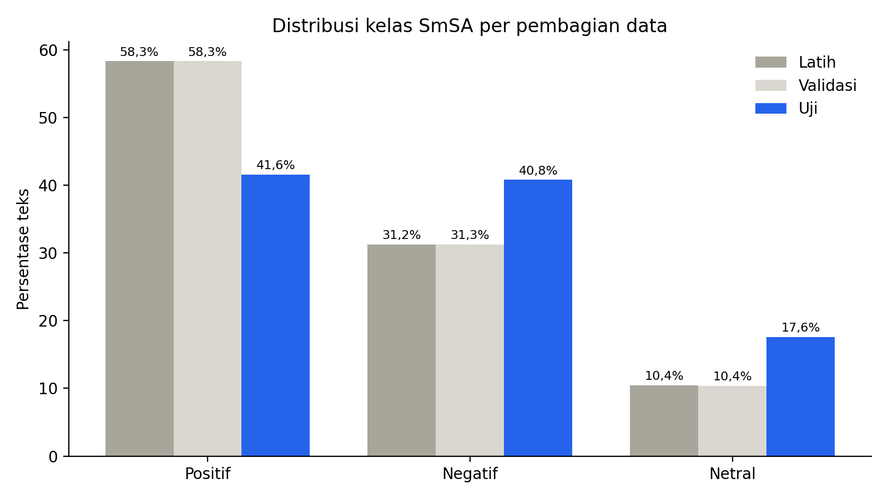

# Hasil Eksplorasi Data SmSA

Dihitung dari berkas yang diunduh dari repositori IndoNLU.

| Pembagian | Jumlah | Positif | Negatif | Netral | Rata-rata kata | Maks kata |
|---|---|---|---|---|---|---|
| Latih | 11.000 | 6.416 (58,3%) | 3.436 (31,2%) | 1.148 (10,4%) | 32,9 | 110 |
| Validasi | 1.260 | 735 (58,3%) | 394 (31,3%) | 131 (10,4%) | 32,5 | 100 |
| Uji | 500 | 208 (41,6%) | 204 (40,8%) | 88 (17,6%) | 24,9 | 90 |

## Temuan penting

1. **Distribusi kelas data uji berbeda dari data latih** (positif 58,3% vs 41,6%; netral 10,4% vs 17,6%). Accuracy saja kurang adil, sehingga macro F1 dipakai sebagai metrik utama.
2. **Satu teks dapat memuat beberapa kalimat** (rata-rata sekitar 33 kata), jadi unit analisis adalah teks ulasan/komentar pendek, bukan satu kalimat.
3. **Kualitas data:** 67 teks duplikat pada data latih; 14 teks sama antara latih dan validasi; 0 teks sama antara latih dan uji; tidak ada nilai kosong.
4. **Data sudah dinormalisasi sebagian oleh penyedia** (huruf kecil, tanda baca dipisahkan spasi). Singkatan seperti gak, bgt, yg hampir tidak ada.
5. **Kata informal** (gue, lo, enggak, aja, kayak, dll.) muncul pada 3,6% teks latih tetapi 20,2% teks uji. Data uji lebih informal daripada data latih; ini mendasari uji ketahanan (E5 dan E6) pada proposal.
6. Panjang maksimum 110 kata berarti panjang maksimum token 128 mungkin memotong sebagian kecil teks; tetapkan nilai akhir setelah menghitung panjang token dengan tokenizer IndoBERT.

