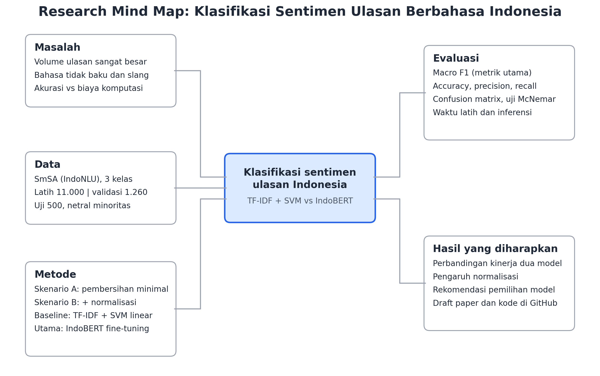

# 04 - Research Mind Map

**Topik riset:** Klasifikasi sentimen ulasan berbahasa Indonesia, TF-IDF + SVM vs IndoBERT (dataset SmSA).

Unduh: [PNG](research-mind-map.png) | [PDF](research-mind-map.pdf)

## Isi cabang

| Cabang | Isi |
|---|---|
| **Masalah** | Volume ulasan sangat besar; bahasa tidak baku dan slang; trade-off akurasi vs biaya komputasi |
| **Data** | SmSA (IndoNLU), 3 kelas; latih 11.000, validasi 1.260, uji 500; kelas netral minoritas |
| **Metode** | Skenario A (pembersihan minimal) dan B (+ normalisasi); baseline TF-IDF + SVM linear; utama IndoBERT fine-tuning |
| **Evaluasi** | Macro F1 (utama), accuracy, precision, recall, confusion matrix, uji McNemar, waktu latih dan inferensi |
| **Hasil yang diharapkan** | Perbandingan kinerja dua model; pengaruh normalisasi; rekomendasi pemilihan model; draft paper dan kode di GitHub |

## Berkas

- `research-mind-map.png`: gambar mind map
- `research-mind-map.pdf`: versi PDF
